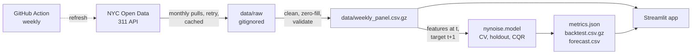

# NYC Noise Forecast

Weekly forecasts of 311 noise complaints for 177 NYC ZIP codes, with calibrated 80% intervals and a dashboard. The point of the project is the evaluation: leakage-safe, baseline-first, with the weak spots reported.

Live app: deploy `streamlit_app.py` on Streamlit Community Cloud (see Deploy).

## Result

Forecast target: complaints in week t+1 for each ZIP, from data up to week t. Scored on the last 52 weeks (2025-11-03 to 2026-10-26, 9,204 ZIP-weeks), never seen during training or model selection.

| Forecast | MAE | WAPE | sMAPE | MASE | R2 |
|---|---|---|---|---|---|
| **Random forest (selected)** | 22.98 | **26.8%** | 28.4% | **0.66** | 0.39 |
| Last week (persistence) | 23.91 | 27.9% | 33.3% | 0.69 | 0.58 |
| Mean of last 4 weeks | 24.60 | 28.7% | 29.6% | 0.71 | 0.18 |
| Histogram gradient boosting | 24.55 | 28.7% | 29.2% | 0.71 | 0.29 |
| Same week last year | 40.26 | 47.0% | 40.6% | 1.16 | -2.18 |

WAPE is total absolute error over total complaints. MASE scales MAE by what a same-week-last-year forecast got wrong on the training years; below 1 is better than that.

**Read it honestly.** The model is 4% better than the best naive forecast on weighted error. That is a modest edge: most of the signal is a ZIP's recent level. It also does worse than persistence on RMSE and R2 (186.9 vs 155.7 RMSE), which means it lags during large jumps in the biggest ZIPs.

Rolling-origin check, refitting before each quarter of the holdout (WAPE, lower is better):

| Quarter | Model | Last week | 4-week mean | Same week last year |
|---|---|---|---|---|
| Nov 2025 to Jan 2026 | 42.1% | **35.8%** | 49.2% | 82.5% |
| Feb to Apr 2026 | **22.4%** | 25.2% | 23.0% | 35.7% |
| May to Jul 2026 | **23.1%** | 28.3% | 23.6% | 30.5% |
| Aug to Oct 2026 | **20.2%** | 22.7% | 20.8% | 42.6% |

The model wins three quarters and loses the first. That quarter contains a surge nothing in the history predicts: citywide weekly totals went from about 14,000 to 20,000-24,000 for three weeks from 2025-11-24, then fell to about 10,000. It is reported, not excluded.

Intervals: 80% nominal, **79.8%** empirical coverage on the holdout. By ZIP, median coverage is 81%, the 10th percentile is 69% and the worst ZIP is 58%.

## What the numbers mean

311 complaints measure how often people report noise, not how loud it is. Differences between ZIPs reflect population, reporting habits and enforcement as much as sound. The project forecasts reporting volume and says so on the dashboard's first screen.

## The dashboard

Five linked views over the committed tables, no network at runtime:

- **Outlook**: a classed map of next week's forecast against each ZIP's own 52-week norm. The band strip above it is the legend, a histogram of ZIPs per class, and a filter. Select a table row to pin a ZIP (up to three); every other tab follows the pins.
- **ZIP replay**: scrub or auto-play through the 52 holdout weeks and watch each forecast, its 80% range and what actually happened, with a plain-language readout and that ZIP's hit rate.
- **Compare**: pinned ZIPs indexed to their own averages, forecast ranges at the right edge.
- **Scorecard**: the baseline race (cumulative error for the model and three naive forecasts, toggleable, all ZIPs or pinned), error by quarter, weekly interval coverage with surge weeks shaded, and the full holdout table.
- **When**: weekday-by-hour heatmap by complaint type.

Design notes live in `PRODUCT.md` and `DESIGN.md`. Fonts (Libre Franklin, Source Serif 4, SIL OFL) are self-hosted in `static/`.

## Pipeline



The app reads committed tables only, so deployment needs no secrets or network. Design choices and rejected alternatives are in [docs/decisions.md](docs/decisions.md); scope and success criteria in [docs/PRD.md](docs/PRD.md).

## Run it

```bash
python -m venv .venv && source .venv/bin/activate
pip install -r requirements-dev.txt
pytest -q                          # 10 tests, about a minute
streamlit run streamlit_app.py     # uses the committed tables in data/
```

Rebuild from the source API (about 3.7M raw rows; resumable, so re-run if the API throttles you; `SOCRATA_APP_TOKEN` speeds it up):

```bash
python -m nynoise.data             # raw -> weekly panel, hourly profile, ZIP positions
python -m nynoise.model            # trains, writes metrics.json, backtest, forecast (about 2 minutes)
```

Training is seeded; rerunning on the committed panel reproduces `data/metrics.json`.

## Deploy

Streamlit Community Cloud: New app, repo `OrenSegal/ny-noise`, branch `main`, main file `streamlit_app.py`, Python 3.12. No secrets. `.github/workflows/refresh.yml` rebuilds the data and model weekly and commits, which redeploys the app.

## Limitations

- Reporting behavior is the target, not sound level.
- No weather or event covariates; abrupt citywide shifts are unforecastable from history.
- ZIP is a postal unit, not a neighborhood. Map positions are the mean complaint location per ZIP, not polygons.
- One tabular model family comparison over a single city and four years of data; no claim beyond that.
- The feature set was fixed before the final evaluation, but one richer variant (more lags, holiday and citywide features) was tried after seeing the first holdout result and dropped because it did not improve CV error. See decisions.
