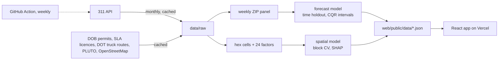

# NYC Noise Field

Where New York is loud, what goes with it block by block, and next week's 311 noise forecast by ZIP code.

**Live: [ny-noise.vercel.app](https://ny-noise.vercel.app)**

Two models, kept apart on purpose:

1. **A spatial model** that explains where complaints concentrate on a ~250 m hex grid, from 24 measured features of the surroundings: expressways, arterials, truck routes, elevated rail, stations, airports, heliports, bars and clubs, restaurants, venues, after-hours construction permits, fire stations, hospitals, parks, and the built form. It explains; it does not forecast, and its effects are associations, not causes.
2. **A forecast** of next week's complaints for each of 177 ZIP codes, with calibrated 80% ranges, scored against naive baselines.

## Results

### Spatial model: what goes with noise near a point

6,523 hex cells (H3 resolution 9), complaints from 2024-11-04 to 2026-11-01. Scored with spatial cross-validation: each fold holds out whole ~36 km² areas, so a cell is never judged by a model that saw its neighbours.

| Model (spatial CV) | Poisson deviance explained | Rank correlation | MAE per cell |
|---|---|---|---|
| **Full: 24 urban factors** | **0.673** | **0.85** | **84** |
| Residential units only (exposure) | 0.608 | 0.79 | 101 |
| Full, random folds (leaky) | 0.741 | 0.87 | 75 |

Urban factors add 0.066 of deviance over exposure alone. Random folds would overstate fit by about the same amount, which is why they are not the headline. Per-type checks all point the expected way: helicopter complaints rise near heliports (Spearman -0.33 with distance), commercial and street complaints with bar density (0.55, 0.44), vehicle complaints with through truck routes (0.06, weak), residential with housing units (0.83).

Strongest associations after exposure: bodega and liquor-store density, commercial floor area, building height, distance to parks, elevated rail, and arterials. Distances to the few airports and stadiums rank high partly because they encode location itself; read them as geography.

### Forecast: next week by ZIP

Scored once on the last 52 weeks (2025-11-03 to 2026-10-26, 9,204 ZIP-weeks), never seen in training or model selection.

| Forecast | MAE | WAPE | sMAPE | MASE | R² |
|---|---|---|---|---|---|
| **Random forest (selected)** | 22.98 | **26.8%** | 28.4% | **0.66** | 0.39 |
| Last week (persistence) | 23.91 | 27.9% | 33.3% | 0.69 | 0.58 |
| Mean of last 4 weeks | 24.60 | 28.7% | 29.6% | 0.71 | 0.18 |
| Histogram gradient boosting | 24.55 | 28.7% | 29.2% | 0.71 | 0.29 |
| Same week last year | 40.26 | 47.0% | 40.6% | 1.16 | -2.18 |

A modest edge: 4% lower weighted error than persistence, ahead in 3 of 4 rolling-origin quarters, behind on RMSE and R² (it lags big jumps in the busiest ZIPs). The quarter it loses holds an unexplained citywide surge (Nov 24 to Dec 8, 2025). 80% intervals covered 79.8% of the holdout; median ZIP 81%.

## The app

- **Sound field**: the five boroughs as a tilted thermal terrain of hex cells. Rings pulse from the hottest blocks, faster where a block is louder than its surroundings predict. Lenses: complaints, expected from the city's fabric, surprise (observed against expected), or any single factor. A month scrubber replays two years.
- **Click any block**: complaint-days against expectation, night share, the factors most associated with its noise as multipliers, complaint types, and a month-by-month trace.
- **Below the map**: factor importance and dependence curves, the sanity checks, next week's ZIP forecast with its backtest, the forecast-versus-baseline race, interval coverage, and a weekday-by-hour heatmap.

React + deck.gl + MapLibre (CARTO dark basemap) + Observable Plot, on Vercel. Fonts: Bricolage Grotesque and Schibsted Grotesk (SIL OFL), self-hosted.

## Pipeline



```bash
python -m venv .venv && source .venv/bin/activate
pip install -r requirements-dev.txt
pytest -q
```

```bash
python -m nynoise.data      # 311 ingest -> weekly ZIP panel
python -m nynoise.model     # forecast, backtest, metrics
python -m nynoise.factors   # hex grid + 24 urban factors (downloads ~150 MB of sources once)
python -m nynoise.spatial   # spatial model, block CV, SHAP drivers
python -m nynoise.export    # JSON for the web app
```

```bash
cd web && npm install && npm run dev
```

Training is seeded; rerunning on the committed tables reproduces the metrics. Set `SOCRATA_APP_TOKEN` to avoid NYC Open Data throttling.

## Limitations

- 311 measures reporting, not sound. A dense, engaged block complains more than an equally loud quiet one.
- Repeat callers dominate raw counts (one Bronx address filed ~150,000 reports in two years). The spatial model counts each address at most once per day per type; the ZIP forecast still models raw volume.
- Factor snapshots are current (2026 licences, permits, roads) against two years of complaints.
- Associations, not causes; distances to rare features partly encode location.
- No weather or event data; abrupt citywide shifts are not predictable from history.

Design choices and what was rejected: [docs/decisions.md](docs/decisions.md). Scope: [docs/PRD.md](docs/PRD.md).
